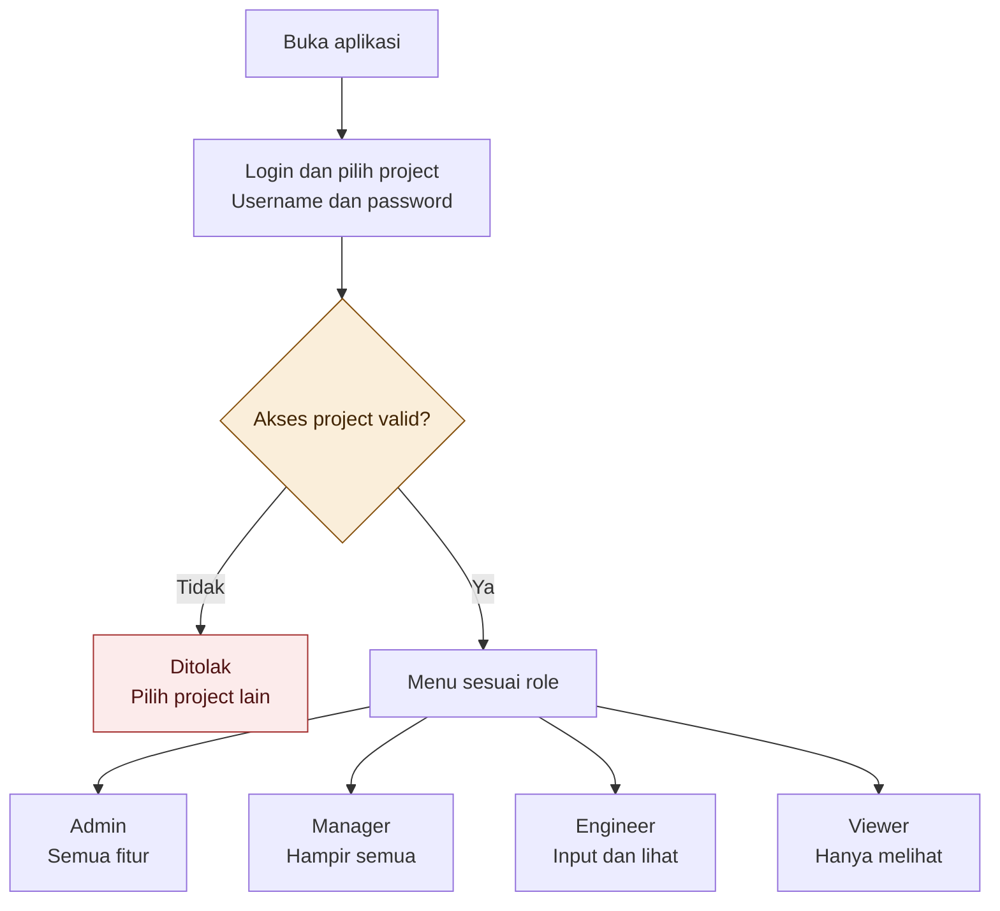
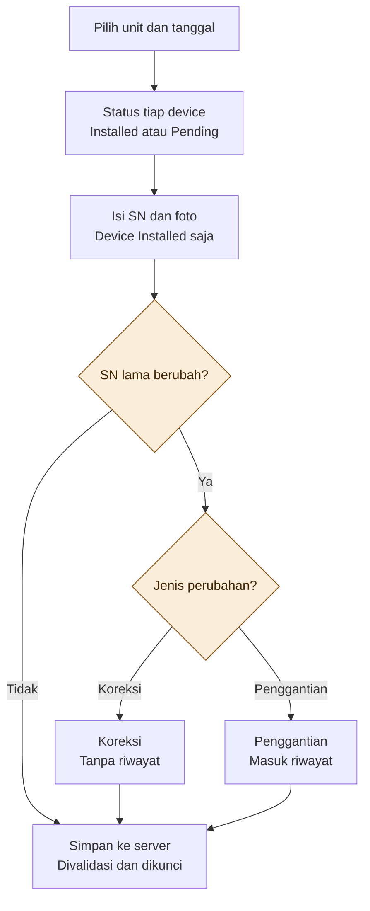
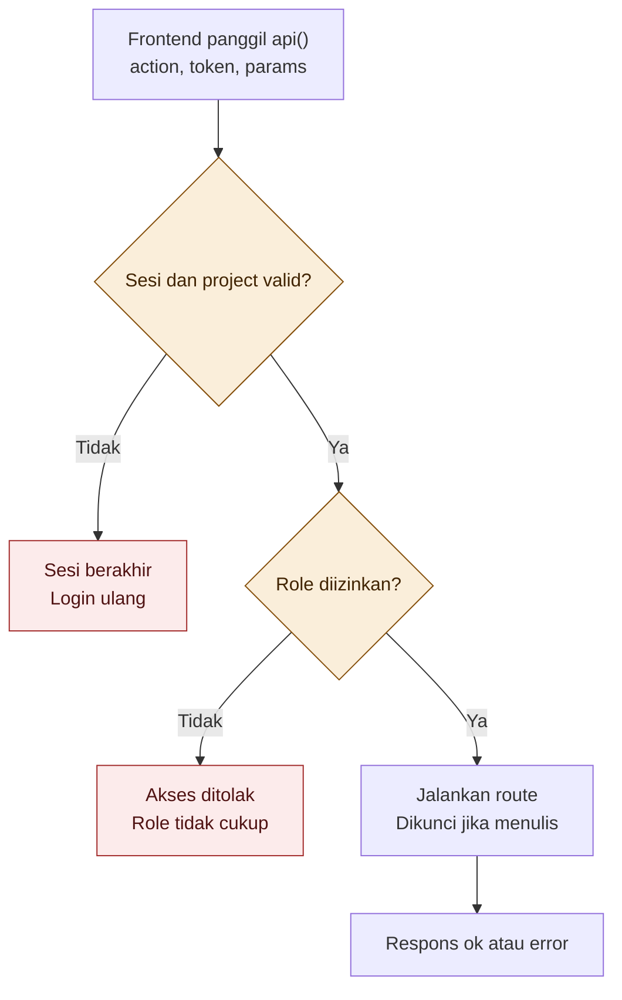

# Flowchart Installation Management System (IMS)

Diagram di bawah ditulis dengan Mermaid. Warna: kuning = keputusan, merah = penolakan, abu-abu = langkah biasa.

## 1. Alur login dan akses menu

Catatan: Manager tidak mendapat Master Project dan Import Data. Kelola artikel Panduan hanya untuk Admin.

## 2. Alur input data instalasi

Catatan: satu unit hanya punya satu data instalasi. Menyimpan ulang memperbarui data yang sama.

## 3. Alur pengecekan setiap request di server

Catatan: aksi publik (login, daftar project di halaman login, dan panduan publik) tidak melewati pengecekan sesi dan role.
